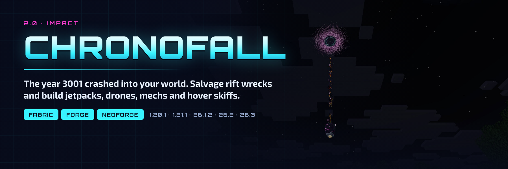

# Chronofall



The year 3001 crashed into your world. At night **Chrono Rifts** tear open in the sky and pods of future tech crash
down, guarded by laser-firing Sentinels. Salvage the wrecks, power everything with cable-free **Flux**, and build a
jetpack, a drone, a rideable mech, a hover skiff, rift gates and a holographic Fabricator.

**2.0 "Impact"** is a full remake of the mod formerly published as **Robotica** and **The Year 3001**: see the
[2.0.0 notes](patchnotes/2.0.0.md), the [design notes](docs/DESIGN-2.0.md) and the [QA record](docs/QA-2.0.0.md)
(84 in-game checks per build, on all ten builds). Old worlds load with their blocks, items and robots migrated.

## Which jar do I download?

Jar names are `chronofall-{loader}-{minecraft}-{modVersion}.jar`. Match **both** the Minecraft version and the loader.

| Minecraft | Java | Fabric jar (needs Fabric API) | NeoForge / Forge jar |
|-----------|------|-------------------------------|----------------------|
| 1.20.1 | 17+ | `chronofall-fabric-1.20.1-2.0.0.jar` | `chronofall-forge-1.20.1-2.0.0.jar` (Forge 47.4.0 or newer) |
| 1.21.1 | 21+ | `chronofall-fabric-1.21.1-2.0.0.jar` | `chronofall-neoforge-1.21.1-2.0.0.jar` (NeoForge 21.1.219 or newer) |
| 26.1.2 | 25+ | `chronofall-fabric-26.1.2-2.0.0.jar` | `chronofall-neoforge-26.1.2-2.0.0.jar` |
| 26.2 | 25+ | `chronofall-fabric-26.2-2.0.0.jar` | `chronofall-neoforge-26.2-2.0.0.jar` (NeoForge 26.2.0.93 or newer) |
| 26.3 | 25+ | `chronofall-fabric-26.3-2.0.0.jar` | `chronofall-neoforge-26.3-2.0.0.jar` (NeoForge 26.3.0.97 or newer) |

Install it on the server and on clients. No other library is needed.

## Features

### Chrono Rifts

Every minute of night each player in the Overworld has a 4 % chance (at most one rift every 15 minutes) of a rift
opening above a spot 24 to 48 blocks away: a ring of magenta light and a rumble. Two seconds later a **Chrono Pod**
falls out of it trailing fire and crashes, digging a small scorched crater (nothing else is destroyed). In the crater
stands a **Rift Cache**, guarded by two or three **Sentinels** (none on Peaceful). Nearby players are told the
direction.

- **Rift Cache**: right-click to crack it open for 2 to 4 Rift Shards, scrap, metal, circuit parts and sometimes a
  processor.
- **Rift Beacon**: right-click it with 4 Rift Shards and it calls a pod down next to itself.
- `/chronofall rift [player]` and `/chronofall rift_at <pos>` start a rift (operators).

### Sentinels

Hostile robots from the rift. They keep their distance and fire a laser bolt (5 damage) every 1.5 to 2 seconds; their visor
glows red in the dark. 30 health, 4 armour. They drop scrap and, when a player kills them, sometimes a Rift Shard.

### The Fabricator

The tech workbench (it replaces the Crafting Workstation). Pick one of 20 recipes from the list, see what you have and
what you need, press **Fabricate**: the ingredients are taken from your inventory and the item prints into the
output slot over a few seconds while a **hologram** of it spins above the block. Hoppers can take the output.

### Flux and the Flux Charger

Every device stores **Flux** and shows it as a charge bar. The **Flux Charger** burns any furnace fuel (coal makes
6,400 Flux) or a Rift Shard (40,000), stores up to 100,000 and, without cables:

- charges the device in its slot,
- charges the jetpack and tools of players within 4 blocks,
- charges drones, mechs and skiffs within 8 blocks, drawing a visible charge beam to each.

A comparator reads its charge; hoppers feed it fuel. A **Flux Cell** right-clicked on a robot or vehicle gives it
4,000 Flux.

### Jetpack

Wear it in the chest slot and hold jump to fly; thruster flames and sound, no fall damage while it has charge, and a
flux gauge on the HUD. 12,000 Flux lasts about 75 seconds of thrust. It works on servers that do not allow flight.

### Hover Skiff

A one-seat flying craft: W/S throttle, A/D turn, jump climbs and sprint descends. It builds up speed, banks into turns
and settles to the ground when you get off. The HUD shows its flux, speed and altitude. 30,000 Flux is about four
minutes of flight. Sneak-right-click with an empty hand to pick it up.

### Drone

A hovering companion that follows the player who deployed it. Right-click it with a chip to install it:

- **Collector chip**: flies to items within 10 blocks and brings them to you.
- **Guard chip**: shoots hostile mobs near you.
- **Lamp chip**: lights up the area around it.

It never attacks its owner. Sneak-right-click with an empty hand to pick it up; it keeps its charge and chips.

### Mech

A rideable walker that steps up full blocks, leaps on jump and **slams** the ground when it lands (8 damage and
knockback around it). Its rider hits 6 harder. Upgrade cards give fixed steps up to a cap: Bulk +10 health (up to
5), Damage +2 (up to 5), Defense +4 armour (up to 5), Speed +10 % (up to 3); the Repair Card heals 20.

### Plasma Cutter and Pulse Rifle

- **Plasma Cutter**: hold use to cut the block you look at, up to 12 blocks away, at a diamond tool's speed, with a
  flux beam. 30 Flux per block.
- **Pulse Rifle**: fires a laser bolt (7 damage) every half second for 60 Flux.

### Rift Gates

Link two gates by right-clicking each with a **Rift Tuner**. Stand on one for two seconds and you arrive at the other,
at any distance and across dimensions.

### Materials

Titanium, cobalt, orichalcum and scrap debris generate underground, and there are four tool and armour sets: scrap
(between stone and iron), titanium (between iron and diamond), cobalt (diamond) and orichalcum (between diamond and
netherite).

## Configuration

`config/chronofall.json` is written on first start, with comments. Changes apply after a restart.

| Key | Default | What it does |
|-----|---------|--------------|
| `rifts.enabled` | `true` | Natural rifts at night |
| `rifts.chance_per_minute` | `0.04` | Chance per player per minute of night |
| `rifts.min_minutes_between` | `15` | Minimum time between two rifts for the same player |
| `rifts.min_distance`, `.max_distance` | `24`, `48` | How far from the player the pod lands |
| `rifts.max_sentinels` | `3` | Sentinels guarding a cache (0 to 8) |
| `rifts.crater` | `true` | Dig and scorch a crater |
| `rifts.announce` | `true` | Tell nearby players where the rift opened |
| `rifts.beacon_shards` | `4` | Rift Shards a Rift Beacon takes |
| `rift_gates.cross_dimension` | `true` | Linked gates may be in different dimensions |
| `rift_gates.charge_ticks`, `.cooldown_ticks` | `40`, `60` | Time on a gate before the jump, and between jumps |
| `robots.mech_slam_damage`, `.mech_slam_radius` | `8.0`, `4.0` | The mech's ground slam |
| `robots.drone_range` | `10` | How far a drone looks for items and mobs |
| `robots.drone_lamp_light` | `true` | The Lamp chip places light |
| `plasma_cutter_range` | `12` | How far the Plasma Cutter reaches |

## Upgrading from Robotica or The Year 3001

Install Chronofall in place of the old jar. Every block, item and robot that 2.0 keeps loads from both old namespaces
(`robotica:` and `theyear3001:`), including renamed ones: the Crafting Workstation becomes a Fabricator, the Boggie a
Drone, the Space Ship a Hover Skiff, the Mech MK1 a Mech and the Empty Card a Blank Card. Oil and the oil bucket are
gone and disappear from old worlds. The Robotica 1.0.1 builds for 26.2 never started, so no 26.2 world needs this.

## Building

Each Minecraft version is a separate MultiLoader Gradle workspace (`common/`, `fabric/` and `neoforge/`, or `forge/`
on 1.20.1). Gradle needs the workspace's Java version: 17 for 1.20.1, 21 for 1.21.1, 25 for 26.x.

```bash
cd 26.3
./gradlew build          # jars in fabric/build/libs and neoforge/build/libs; runs the unit tests
```

`tools/build_release.sh` builds every workspace and copies the jars into `releases/` for the publish workflow.
Release notes for a version live in `patchnotes/<version>.md`; see [CONTRIBUTING](CONTRIBUTING.md) for the asset
generators and the in-game QA.

## Links

[Discord](https://discord.gg/SAmd9fhNhr) · [Source and issues](https://github.com/MeherBenSalem/TheYear3001) ·
[Support us](https://nightbeam.dev/support) · Made by NightBeam Studio

Licensed under the [Apache License 2.0](LICENSE).
